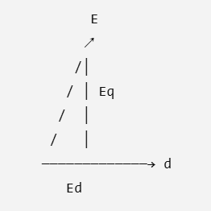
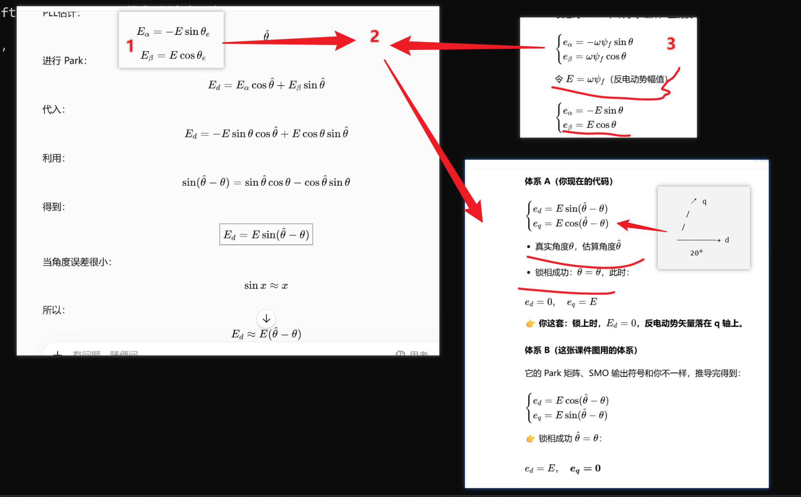

哈哈，行，这次**不讲一堆分支**，就给你一条线。

你现在就记住这一套：

> **SMO → Eα/Eβ → PLL → θe**
>
> 这就是无感 FOC 里非常常见的一种 **反电动势 PLL（Back-EMF PLL）**实现思路。

而且我们直接讲最容易写代码的版本：**反电动势矢量 + Park 鉴相 + PI + 积分**。

---

# 1. 先看最终流程

你只需要记住这张图：

```text
                 电机
                  │
             Uα Uβ / Iα Iβ
                  │
                  ↓
                SMO
                  │
             Eα      Eβ
              │       │
              └───┬───┘
                  ↓
          ┌────────────────┐
          │      PLL       │
          │                │
          │ Eα Eβ          │
          │   ↓            │
          │ Park(θ_est)    │
          │   ↓            │
          │    Ed / Eq     │
          │   ↓            │
          │   误差          │
          │   ↓            │
          │    PI          │
          │   ↓            │
          │   ωe           │
          │   ↓            │
          │    ∫           │
          │   ↓            │
          │   θe           │
          └───────┬────────┘
                  │
                  ↓
              FOC使用θe
```

**PLL就干这一件事：**

> 根据 `Eα/Eβ` 这两个反电动势分量，算出电机当前的**电角度 θe**。

---

# 2. SMO到底给PLL什么？

SMO最终给你：

```c
Ealpha
Ebeta
```

例如某一个时刻：

```text
Eα = -2.0V
Eβ =  3.0V
```

你可以把它理解成一个二维矢量：

```text
              β
              ↑
              │       E
              │      ↗
              │     /
              │    /
              │   /
              └──────────→ α
```

所以：

> **Eα、Eβ 本质上就是一个旋转的反电动势矢量。**

这个矢量一直随着电机转子旋转。

---

# 3. 最简单的想法：atan2直接算角度

你可能会说：

```c
theta = atan2(Ebeta, Ealpha);
```

确实！

数学上：

$$
\theta=\operatorname{atan2}(E_\beta,E_\alpha)
$$

就可以得到这个矢量角度。

但是：

> **实际 FOC 里面通常不会直接拿 atan2 当最终角度估计器。**

原因是 SMO 的 `Eα/Eβ` 有：

* PWM噪声
* ADC噪声
* SMO抖振
* 参数误差
* 采样噪声
* 反电动势谐波

所以：

```text
SMO
 ↓
Eα/Eβ
 ↓
atan2
 ↓
角度疯狂抖
```

然后：

```text
θ
 ↓
Park
 ↓
电流环
```

就很容易：

> **电机嗡嗡响。**

这也是你之前 SMO 直接 `atan2()` 后电机噪声很大的重要原因之一。

---

# 4. PLL就是用来解决这个问题的

PLL不要直接：

```text
Eα/Eβ
 ↓
atan2
 ↓
θ
```

而是：

```text
Eα/Eβ
 ↓
PLL
 ↓
平滑的 θ
```

它的核心思想特别简单：

> **我自己内部维护一个“估计角度 θ_est”，然后不断拿它和 SMO 给我的反电动势方向比较。**

---

# 5. PLL内部有一个“假想转子”

PLL里面自己维护：

```c
theta_est
omega_est
```

比如：

```text
theta_est = 80°
omega_est = 5000 rad/s
```

PLL认为：

> “我觉得现在转子电角度是80°，而且正在以5000rad/s转。”

但 SMO 给它：

```text
Ealpha
Ebeta
```

告诉它：

> “真实反电动势方向其实在这里。”

PLL就比较：

```text
       SMO真实方向
            ↓
          Eα/Eβ
             \
              \
               ↓
              PLL
               ↑
              θ_est
       我自己认为的位置
```

如果不一致：

```text
误差 ≠ 0
```

PLL就调整自己的速度。

---

# 6. 最常用、最好理解的PLL结构

我们直接采用：

> **SRF-PLL / Synchronous Reference Frame PLL**

也就是：

> **同步旋转坐标系PLL。**

它的核心就是：

```text
Eα/Eβ
  ↓
Park(θ_est)
  ↓
Eq
  ↓
PI
  ↓
ωe_est
  ↓
积分
  ↓
θe_est
```

这个结构你以后看到基本就认识了。

---

# 7. 第一步：PLL拿到Eα/Eβ

假设SMO输出：

```c
Ealpha
Ebeta
```

例如：

```text
Ealpha = -2.0
Ebeta  = 3.0
```

PLL内部现在有：

```c
theta_est
```

比如：

```text
theta_est = 50°
```

---

# 8. 第二步：PLL自己生成sin/cos

```c
sin_theta = sin(theta_est);
cos_theta = cos(theta_est);
```

---

# 9. 第三步：把Eα/Eβ变换到PLL自己的dq坐标系

使用Park：

$$
E_d =
E_\alpha\cos\theta_{est}
+
E_\beta\sin\theta_{est}
$$

$$
E_q =
-E_\alpha\sin\theta_{est}
+
E_\beta\cos\theta_{est}
$$

代码：

```c
Ed =
    Ealpha * cos_theta
  + Ebeta  * sin_theta;

Eq =
   -Ealpha * sin_theta
  + Ebeta  * cos_theta;
```

---

# 10. 为什么要做这个Park？

这是PLL最关键的一步。

你可以把它理解成：

> **PLL拿自己的角度 θ_est 建立一个坐标系，然后看看SMO得到的反电动势矢量在这个坐标系里面歪了多少。**

如果：

```text
θ_est = 真实角度
```

那么：

```text
Eq ≈ 0
```

也就是说：

> **Eq就是“角度没对准”的信息。**

所以：

```text
Eq
 ↓
PI
```

---

# 11. 为什么Eq可以代表角度误差？

假设真实反电动势矢量：

```text
              E
             ↗
            /
           /
          /
```

而PLL自己的坐标轴：

```text
              q
             ↗
            /
           /
          d ─────────
```

如果两者没对齐：

```text
             E
            ↗
           /
          /
         /
        ─────────→ d
```

那么E在q轴方向一定有分量：

```text
Eq ≠ 0
```

如果PLL角度慢慢追上：

```text
             E
             │
             │
             │
             ↓
        ─────────→ d
```

那么：

```text
Eq → 0
```

所以：

$$
\boxed{Eq\rightarrow0}
$$

就意味着：

> **PLL已经锁住了。**

---

# 12. 但是这里有一个非常重要的坑

到底是：

```c
Eq
```

还是：

```c
Ed
```

作为误差信号？

**取决于你的 Eα/Eβ 定义。**

为了让你现在不要再晕，我们直接规定一套。

假设你的 SMO 定义：

$$
E_\alpha=-E\sin\theta_e
$$

$$
E_\beta=E\cos\theta_e
$$

那么反电动势实际上比转子磁链方向**超前90°**。

这种情况下，如果你直接：

```c
Park(Ealpha,Ebeta,theta_est)
```

那么PLL里的误差信号可能表现为 `Ed`。

所以：

> **不能看到别人的代码写 Eq，你就照抄 Eq。**

---

# 13. 最稳妥的方法：直接从数学关系推

假设：

$$
E_\alpha=-E\sin\theta
$$

$$
E_\beta=E\cos\theta
$$

PLL估计：

$$
\hat\theta
$$

进行 Park：

$$
E_d =
E_\alpha\cos\hat\theta+
E_\beta\sin\hat\theta
$$

代入：

$$
E_d=
-E\sin\theta\cos\hat\theta
+
E\cos\theta\sin\hat\theta
$$

利用：

$$
\sin(\hat\theta-\theta)
=
\sin\hat\theta\cos\theta
-
\cos\hat\theta\sin\theta
$$

得到：

$$
\boxed{
E_d=E\sin(\hat\theta-\theta)
}
$$

当角度误差很小：

$$
\sin x\approx x
$$

所以：

$$
E_d\approx E(\hat\theta-\theta)
$$

这就意味着：

> **Ed直接正比于角度误差。**

所以对于这个定义：

```text
Ed
 ↓
PLL PI
```

是正确的。

---

# 14. 这就是为什么不同资料让你看晕

因为有人定义：

$$
E_\alpha=E\cos\theta
$$

$$
E_\beta=E\sin\theta
$$

那它的PLL误差信号可能变成：

```text
Eq
```

而你现在如果 SMO 输出定义是：

$$
E_\alpha=-E\sin\theta
$$

$$
E_\beta=E\cos\theta
$$

那么：

```text
Ed
```

才是误差。

所以以后别问：

> “PLL到底用Ed还是Eq？”

应该问：

> **“我的Eα/Eβ定义是什么？哪个dq轴分量在锁定时应该趋近于0？”**

---

# 15. 我建议你现在就采用这一套定义

为了避免你继续乱，我们规定：

```c
Ealpha = -E * sin(theta_e);
Ebeta  =  E * cos(theta_e);
```

那么PLL：

```text
Eα/Eβ
 ↓
Park(θ_est)
 ↓
Ed
 ↓
PI
 ↓
ωe_est
 ↓
积分
 ↓
θe_est
```

这套你就先用。

---

# 16. 第四步：Ed进入PI

假设：

```text
Ed = +0.2
```

说明：

```text
theta_est - theta_real > 0
```

也就是：

> PLL估计角度偏快/偏前。

PI：

$$
\omega_{e,est}
=
K_pE_d
+
K_i\int E_ddt
$$

代码：

```c
error = Ed;

integral += Ki * error * Ts;

omega_est =
    Kp * error
    + integral;
```

但是实际一般还会加上一个**速度基值/积分状态**，更准确的写法是：

```c
omega_est =
    omega_integrator
    + Kp * error;
```

其中：

```c
omega_integrator += Ki * error * Ts;
```

---

# 17. 为什么PI输出的是速度？

因为PLL本质是：

```text
角度误差
 ↓
调整速度
 ↓
速度积分
 ↓
角度
```

不是：

```text
角度误差
 ↓
直接变成角度
```

所以：

```text
Ed
 ↓
PI
 ↓
ωe
 ↓
积分
 ↓
θe
```

这是PLL最核心的结构。

---

# 18. 第五步：积分得到电角度

有了：

```c
omega_est
```

根据：

$$
\frac{d\theta_e}{dt}=\omega_e
$$

离散化：

$$
\theta_e[k]
=
\theta_e[k-1]
+
\omega_e[k]T_s
$$

代码：

```c
theta_est += omega_est * Ts;
```

然后限制到：

```text
0 ~ 2π
```

例如：

```c
if(theta_est >= TWO_PI)
    theta_est -= TWO_PI;

if(theta_est < 0)
    theta_est += TWO_PI;
```

于是：

$$
\boxed{\theta_{e,est}}
$$

就出来了。

---

# 19. 所以PLL完整代码其实非常短

你可以先写成：

```c
typedef struct
{
    float kp;
    float ki;

    float integral;

    float omega_est;
    float theta_est;

} pll_t;
```

初始化：

```c
void PLL_Init(pll_t *pll)
{
    pll->kp = ...;
    pll->ki = ...;

    pll->integral = 0.0f;

    pll->omega_est = 0.0f;
    pll->theta_est = 0.0f;
}
```

---

# 20. PLL更新函数

按照我们刚才规定的：

$$
E_\alpha=-E\sin\theta
$$

$$
E_\beta=E\cos\theta
$$

采用 `Ed` 做误差。

伪代码：

```c
void PLL_Update(
    pll_t *pll,
    float Ealpha,
    float Ebeta)
{
    //--------------------------------
    // 1. 当前PLL角度
    //--------------------------------

    theta = pll->theta_est;


    //--------------------------------
    // 2. sin/cos
    //--------------------------------

    sin_theta = sin(theta);
    cos_theta = cos(theta);


    //--------------------------------
    // 3. Eαβ → PLL dq
    //--------------------------------

    Ed =
        Ealpha * cos_theta
      + Ebeta  * sin_theta;

    Eq =
       -Ealpha * sin_theta
      + Ebeta  * cos_theta;


    //--------------------------------
    // 4. PLL相位误差
    //--------------------------------

    error = Ed;


    //--------------------------------
    // 5. PI
    //--------------------------------

    pll->integral +=
        pll->ki * error * Ts;

    pll->omega_est =
        pll->integral
        + pll->kp * error;


    //--------------------------------
    // 6. 角速度积分
    //--------------------------------

    pll->theta_est +=
        pll->omega_est * Ts;


    //--------------------------------
    // 7. 角度归一化
    //--------------------------------

    if(pll->theta_est >= TWO_PI)
        pll->theta_est -= TWO_PI;

    if(pll->theta_est < 0)
        pll->theta_est += TWO_PI;
}
```

**这就是完整的核心PLL。**

---

# 21. 但是这个版本还有一个非常重要的问题

如果你直接：

```c
omega_est =
    integral
    + Kp * Ed;
```

当：

```text
电机突然加速
```

或者：

```text
SMO输出有噪声
```

可能会出现：

```text
omega_est
```

瞬间异常。

所以工程代码一般还会：

```text
误差限幅
积分限幅
速度限幅
角度归一化
```

例如：

```c
error = clamp(Ed, -E_MAX, E_MAX);

integral += Ki * error * Ts;

integral =
    clamp(integral,
          OMEGA_MIN,
          OMEGA_MAX);

omega_est =
    integral
    + Kp * error;

omega_est =
    clamp(omega_est,
          OMEGA_MIN,
          OMEGA_MAX);
```

---

# 22. 还有一个更重要的问题：反电动势幅值会影响PLL

注意：

$$
E_d\approx E(\hat\theta-\theta)
$$

所以：

$$
E_d
$$

不仅包含：

```text
角度误差
```

还乘了：

```text
反电动势幅值 E
```

也就是说：

```text
高速：

E 很大
 ↓
Ed很敏感
```

低速：

```text
E 很小
 ↓
Ed很弱
```

这就是为什么：

> **SMO + Back-EMF PLL低速性能天然比较差。**

---

# 23. 所以实际工程经常对PLL误差做归一化

例如：

$$
E_{mag}=\sqrt{E_\alpha^2+E_\beta^2}
$$

然后：

$$
error=
\frac{E_d}{E_{mag}}
$$

于是：

```c
E_mag =
    sqrt(Ealpha*Ealpha
       + Ebeta*Ebeta);

if(E_mag > MIN_EMF)
{
    error = Ed / E_mag;
}
else
{
    error = 0;
}
```

这样：

$$
\frac{E_d}{E}
\approx
\sin(\theta_{est}-\theta)
$$

小角度时：

$$
\frac{E_d}{E}
\approx
\theta_{est}-\theta
$$

这就非常漂亮了。

---

# 24. 我反而建议你用这个版本

你的PLL伪代码：

```c
void PLL_Update(
    pll_t *pll,
    float Ealpha,
    float Ebeta)
{
    //-------------------------------------
    // 1. 获取当前估计角度
    //-------------------------------------

    theta = pll->theta_est;


    //-------------------------------------
    // 2. sin / cos
    //-------------------------------------

    s = sin(theta);
    c = cos(theta);


    //-------------------------------------
    // 3. 反电动势 Park
    //-------------------------------------

    Ed =
        Ealpha * c
      + Ebeta  * s;

    Eq =
       -Ealpha * s
      + Ebeta  * c;


    //-------------------------------------
    // 4. 计算反电动势幅值
    //-------------------------------------

    E_mag =
        sqrt(Ealpha*Ealpha
           + Ebeta*Ebeta);


    //-------------------------------------
    // 5. 归一化相位误差
    //-------------------------------------

    if(E_mag > MIN_EMF)
    {
        error = Ed / E_mag;
    }
    else
    {
        error = 0;
    }


    //-------------------------------------
    // 6. PI
    //-------------------------------------

    pll->integral +=
        pll->ki
        * error
        * Ts;


    //-------------------------------------
    // 7. PI输出电角速度
    //-------------------------------------

    pll->omega_est =
        pll->integral
        + pll->kp * error;


    //-------------------------------------
    // 8. 角速度积分
    //-------------------------------------

    pll->theta_est +=
        pll->omega_est * Ts;


    //-------------------------------------
    // 9. 角度归一化
    //-------------------------------------

    while(pll->theta_est >= TWO_PI)
        pll->theta_est -= TWO_PI;

    while(pll->theta_est < 0)
        pll->theta_est += TWO_PI;
}
```

---

# 25. 你现在把PLL压缩成这5步

真的不要再记复杂的。

### 第一步

SMO：

```text
Uα/Uβ + Iα/Iβ
       ↓
      SMO
       ↓
    Eα/Eβ
```

---

### 第二步

PLL拿到：

```text
Eα/Eβ
```

---

### 第三步

用自己当前认为的角度：

```text
θ_est
```

进行：

```text
Eα/Eβ
 ↓
Park
 ↓
Ed
```

---

### 第四步

：

```text
Ed
 ↓
PI
 ↓
ωe
```

---

### 第五步

：

```text
ωe
 ↓
积分
 ↓
θe
```

完成。

所以最终：

$$
\boxed{
E_{\alpha,\beta}
\rightarrow
Park(\hat\theta)
\rightarrow
E_d
\rightarrow
PI
\rightarrow
\hat\omega_e
\rightarrow
积分
\rightarrow
\hat\theta_e
}
$$

---

# 26. 你甚至可以不用理解“锁相环”三个字

你就把它当成：

> **一个自动追踪电机反电动势方向的角度跟踪器。**

它自己有：

```text
theta_est
```

SMO告诉它：

```text
Eα/Eβ
```

它比较：

```text
我的角度
vs
反电动势方向
```

发现偏了：

```text
→ 调速度
```

速度改变：

```text
→ 积分
```

角度改变：

```text
→ 再比较
```

直到：

```text
误差 → 0
```

然后：

```text
theta_est ≈ 电机真实电角度
```

**这就是 PLL。**

---

## 最后给你一个最重要的“程序脑图”

你以后写代码就按照这个顺序写：

```text
              【SMO】
                 │
                 ↓
          Ealpha / Ebeta
                 │
                 ↓
       ┌──────────────────┐
       │       PLL        │
       │                  │
       │ theta_est        │
       │    │             │
       │    ↓             │
       │ sin/cos          │
       │    │             │
       │    ↓             │
       │ Park(Eα,Eβ)      │
       │    │             │
       │    ↓             │
       │     Ed           │
       │    │             │
       │    ↓             │
       │ / E_mag          │
       │    │             │
       │    ↓             │
       │    PI            │
       │    │             │
       │    ↓             │
       │  omega_est       │
       │    │             │
       │    ↓             │
       │  积分            │
       │    │             │
       │    ↓             │
       │ theta_est        │
       └────┬─────────────┘
            │
            ↓
      FOC Park / 反Park
            │
            ↓
           电机
```

**你现在真正需要写的就两个模块：**

```c
SMO_Update()
```

负责：

```text
Uα/Uβ + Iα/Iβ
        ↓
     Eα/Eβ
```

以及：

```c
PLL_Update()
```

负责：

```text
Eα/Eβ
 ↓
θe
```

然后把：

```c
pll.theta_est
```

拿给你的 FOC `Park()`。

这条链路先跑通，**不要同时加入 MTPA、弱磁、解耦优化、高频注入、Luenberger、复杂PLL滤波这些东西**。你现在最应该先把 **“SMO到底输出什么 → PLL到底怎么从Eα/Eβ得到θe → θe怎么反馈给FOC”** 这一条链彻底跑通。


--------------
-------------
--------------
# FAQ(问题总结)
## 1.为什么 θ_est = 真实角度 时，Eq ≈ 0？为什么 Eq 能拿去给 PI？
对，你卡住的地方其实就是 **PLL 最核心的一步**。我换一种方式，不讲复杂控制理论，直接用“两个箭头对不对齐”给你讲。

你问的是：

> **为什么 `θ_est = 真实角度` 时，Eq ≈ 0？为什么 Eq 能拿去给 PI？**

先只看这一件事。

---

# 1. 先别管 FOC、SMO

假设 SMO 已经给了我们：

```text
Eα
Eβ
```

这两个数合起来就是一个箭头：

```text
                β
                ↑
                │
                │       E
                │      ↗
                │     /
                │    /
                │   /
                └────────────→ α
```

这个箭头就是：

> **反电动势矢量 E**

假设它现在指向：

```text
30°
```

也就是说：

```text
真实 E 方向 = 30°
```

---

# 2. PLL自己也有一个角度

PLL内部有：

```c
theta_est
```

比如它现在认为：

```text
theta_est = 20°
```

所以 PLL 自己建立了一个坐标系：

```text
                 β
                 ↑
                 │
              E ↗│
               / │
              /  │
             /   │
            /    │
           /     │
          └────────────→ α

             ↗ q
            /
           /
          ─────────→ d
             20°
```

也就是说：

```text
真实 E方向 = 30°
PLL估计方向 = 20°
```

两者差：

```text
10°
```

---

# 3. 现在PLL干了一件事情

PLL说：

> “我不直接计算 atan2，我把 Eα/Eβ 旋转到我自己的坐标系里面看看。”

于是做：

```text
Eα/Eβ
   ↓
Park(theta_est)
   ↓
Ed/Eq
```

这里的 `theta_est = 20°`。

---

# 4. Park之后的Ed/Eq是什么？

你可以把它想成：

```text
                E
               ↗
              /
             /
            /
           /
          ─────────────→ d
              10°
```

E没有完全落在 d 轴上。

所以它会分成两个部分：

```text
                E
               ↗
              /│
             / │ Eq
            /  │
           /   │
          ─────────────→ d
             Ed
```

所以：

```text
Ed = E在d方向上的投影

Eq = E在q方向上的投影
```

---

# 5. 现在看最关键的情况

假设：

```text
真实 E方向 = 20°
PLL theta_est = 20°
```

那么：

```text
             E
             │
             │
             │
             ↓
          ─────────────→ d
```

E刚好和 d 轴重合。

那么：

```text
Ed = E

Eq = 0
```

所以：

$$
\boxed{Eq=0}
$$

这就是：

> **为什么两个方向对齐以后，垂直方向的分量为0。**

---

# 6. 但是！！！！这里就是你刚才容易被我绕晕的地方

我前面说：

> `θ_est = 真实角度 → Eq ≈ 0`

这个说法**不是永远成立**。

它取决于：

> **你定义的 Eα/Eβ 到底指向哪里。**

如果我们规定：

$$
E_\alpha=E\cos\theta
$$

$$
E_\beta=E\sin\theta
$$

那么 E 矢量方向就是：

$$
\theta
$$

此时：

```text
真实E方向
    ↓
    θ

PLL角度
    ↓
 theta_est
```

如果：

```text
theta_est = theta
```

那么：

```text
E
↓
d轴
```

所以：

```text
Eq = 0
```

**这种定义下用 Eq 做 PLL 误差非常直观。**

---

# 7. 但是PMSM反电动势经常是另外一种定义

PMSM常见：

$$
E_\alpha=-E\sin\theta
$$

$$
E_\beta=E\cos\theta
$$

注意这个：

```text
-E sinθ
 E cosθ
```

这意味着 E 矢量实际上比 `θ` **转了90°**。

例如：

```text
转子角度 θ = 30°
```

反电动势方向可能是：

```text
θ + 90° = 120°
```

所以这时候你如果直接拿：

```text
Eα/Eβ
```

去 Park：

```text
Park(theta_est)
```

那么：

```text
Ed/Eq
```

的意义就和刚才不一样了。

这就是为什么我前面一直强调：

> **不要死记“PLL一定用Ed”或者“一定用Eq”。**

---

# 8. 你现在最应该理解的是“投影”

PLL里面：

```text
Eα/Eβ
     ↓
   Park
     ↓
 Ed / Eq
```

本质上没有什么神秘东西。

就是：

> **把一个箭头投影到 PLL 自己建立的 d/q 两根轴上。**

例如：

```text
                  E
                 ↗
                /|
               / |
              /  |  Eq
             /   |
            /    |
           ─────────────→ d
               Ed
```

其中：

```text
Ed = E在d轴上的长度

Eq = E在q轴上的长度
```

---

# 9. PLL为什么要看其中一个？

因为我们想知道：

> **E这个箭头和我的d轴到底偏了多少。**

如果：

```text
E 和 d轴完全重合
```

那么：

```text
Eq = 0
```

如果：

```text
E 在d轴上面偏了一点
```

那么：

```text
Eq > 0
```

如果：

```text
E 在d轴下面偏了一点
```

那么：

```text
Eq < 0
```

所以：

```text
             Eq > 0
               ↗
              /
             /
────────────→ d
             \
              \
               ↘
             Eq < 0
```

这就是一个非常漂亮的：

> **角度误差检测器。**

---

# 10. 所以PI到底在干什么？

假设：

```text
Eq > 0
```

PLL理解成：

> “卧槽，我的角度没跟上，赶紧调整。”

于是：

```text
Eq
 ↓
PI
 ↓
ω_est增加
 ↓
theta_est增加
```

然后：

```text
theta_est
```

就往真实角度靠近。

---

# 11. 如果Eq < 0呢？

反过来：

```text
Eq < 0
 ↓
PI
 ↓
ω_est减小
 ↓
theta_est往另一个方向调整
```

最终：

```text
Eq → 0
```

也就是：

```text
E方向
   ↓
   和
   ↓
PLL的d轴
```

完全对齐。

---

# 12. 所以PLL其实就是一个“自动对齐器”

你可以把它想成：

```text
              SMO给的真实方向
                     ↓
                     E
                    ↗
                   /
                  /
                 /
                /
               ─────────→ PLL d轴
```

PLL不断调整：

```text
theta_est
```

直到：

```text
E
│
│
↓
──────────────→ d
```

此时：

```text
Eq = 0
```

然后PLL说：

> **“好了，我的角度已经跟上电机了。”**

---

# 13. 再说一遍“为什么Eq可以给PI”

因为：

$$
Eq
$$

的**正负告诉你应该往哪个方向调整**：

```text
Eq > 0
→ 角度往一个方向调

Eq < 0
→ 角度往反方向调

Eq = 0
→ 不需要调整
```

而：

$$
|Eq|
$$

又大致反映：

> **偏得有多厉害。**

所以它天然适合做：

```text
              Eq
               ↓
             PI控制器
               ↓
            ωe_est
               ↓
              积分
               ↓
            θe_est
```

---

# 14. 但我现在纠正一个非常重要的地方

**如果你现在是准备真正给你自己的 SMO 写 PLL，我不建议你先死磕“Eq还是Ed”。**

你应该先确定你自己的 SMO 输出定义。

例如你代码里面：

```c
smo->Ealpha = ...;
smo->Ebeta  = ...;
```

到底满足：

```text
Ealpha = -E*sin(theta)
Ebeta  =  E*cos(theta)
```

还是：

```text
Ealpha = E*cos(theta)
Ebeta  = E*sin(theta)
```

或者符号反了。

**这个决定你的PLL到底应该使用 Ed 还是 Eq，以及PI正负号。**

---

# 15. 对你现在这个项目，最简单的理解

你先暂时忘掉 `Ed/Eq` 这些名字。

直接记：

```text
SMO
 ↓
得到一个旋转箭头 Eα/Eβ
 ↓
PLL自己也有一个角度 θ_est
 ↓
用 θ_est 建立两根轴
 ↓
看 E 箭头在“垂直轴”上还有多少
 ↓
垂直分量 = 角度误差
 ↓
PI调整速度
 ↓
积分得到角度
```

就是：

```text
Eα/Eβ
   ↓
“和我的角度对齐了吗？”
   ↓
没有
   ↓
误差
   ↓
PI
   ↓
调整速度
   ↓
调整θ
   ↓
重新比较
   ↓
对齐
```

**这才是 PLL 的本质。**

如果你愿意，我下一步可以直接拿一个具体数字，比如 **`Eα=-2V、Eβ=3V、θ_est=30°`**，一步一步把 `sin/cos → Park → Ed/Eq → PI → ω → θ` **每一个数都算出来**。这样你就能彻底看懂 PLL 到底是怎么算出电角度的。


------------


---------------

----------
-------------
## 2. 为什么Eq可以代表角度误差？


对，**现在终于能针对你这份代码讲了**。

你之所以一直觉得 `Eq / Ed` 很晕，是因为前面没有把**你自己的 SMO 输出定义**固定下来。

而你代码里已经明确写了：

```c
// ebmf_alpha = -E*sin(theta)
// ebmf_beta  =  E*cos(theta)
```

所以我们现在**完全按照你这份代码来推**。

先给你结论：

> **你的 SMO 定义下，PLL应该使用 `Ed` 作为相位误差信号，而不是 `Eq`。**
>
> 然后：
>
> ```text
> SMO → Eα/Eβ
>        ↓
> PLL用当前θ_est做Park
>        ↓
> Ed
>        ↓
> PI
>        ↓
> ωe_est
>        ↓
> 积分
>        ↓
> θe_est
> ```
>
> 而且你现在 SMO 里的 `atan2f()` 可以去掉，让 PLL 来负责产生 `theta_e`。

下面我就**只围绕你的代码**讲。

---

# 一、先看你SMO最终到底输出了什么

你的代码最终得到：

```c
smo->ebmf_alpha
smo->ebmf_beta
```

你自己定义的是：

```text
Eα = -E sin(θ)
Eβ =  E cos(θ)
```

这两个式子非常重要。

我们先不要管 PLL。

---

# 二、假设电机现在转到了 θ = 30°

假设：

$$
\theta=30^\circ
$$

假设反电动势幅值：

$$
E=10V
$$

那么你的 SMO 输出应该是：

$$
E_\alpha=-10\sin30^\circ=-5V
$$

$$
E_\beta=10\cos30^\circ=8.66V
$$

所以：

```text
Eα = -5V
Eβ =  8.66V
```

这两个数实际上就是一个箭头。

画出来：

```text
                β
                ↑
                │
                │       E
                │      ↗
                │     /
                │    /
                │   /
                └────────────→ α
```

但是注意：

因为你定义的是：

```text
Eα = -E sinθ
Eβ =  E cosθ
```

所以这个 E 反电动势箭头的实际方向不是 `30°`。

而是：

$$
\boxed{\theta+90^\circ}
$$

也就是：

$$
30^\circ+90^\circ=120^\circ
$$

所以：

```text
真实转子电角度 = 30°
真实反电动势方向 = 120°
```

**这个90°就是你之前一直被绕晕的根源。**

---

# 三、你的 atan2 为什么能算出30°？

你代码：

```c
smo->theta_e =
    -atan2f(
        smo->ebmf_alpha,
        smo->ebmf_beta
    );
```

代入：

```text
Eα = -5
Eβ = 8.66
```

得到：

$$
atan2(-5,8.66)=-30^\circ
$$

再加负号：

$$
\theta=-(-30^\circ)=30^\circ
$$

所以：

```c
theta = -atan2(Ealpha, Ebeta);
```

**对于你现在定义的 Eα/Eβ，这个公式是成立的。**

---

# 四、现在进入PLL

我们现在假设：

真实：

```text
θ_real = 30°
```

但是 PLL 一开始不知道。

PLL自己猜：

```text
θ_est = 20°
```

这很正常。

所以现在：

```text
真实角度：

θ_real = 30°

PLL认为：

θ_est = 20°
```

PLL要做的事情就是：

> **想办法把20°慢慢变成30°。**

---

# 五、PLL为什么要Park？

这是最关键的一步。

PLL说：

> “我现在认为转子是20°，那我就建立一个20°的坐标系。”

于是 PLL 有：

```text
d轴
q轴
```

注意：

### d轴方向

就是 PLL 当前认为的：

```text
θ_est = 20°
```

而你的反电动势方向是：

```text
θ_real + 90°
=
120°
```

所以现在：

```text
真实E方向 = 120°

PLL d轴   = 20°
```

两者相差：

```text
100°
```

这看起来怎么这么大？

别急。

---

# 六、关键：PLL实际上不应该把“反电动势E”直接对齐d轴

这就是你之前真正被我绕晕的地方。

你的：

```text
Eα = -E sinθ
Eβ =  E cosθ
```

代表：

> **反电动势 E 比转子磁链方向领先90°。**

所以如果：

```text
转子角度 θ = 30°
```

那么：

```text
转子d轴 = 30°

反电动势E方向 = 120°
```

所以真正正确的 PLL 坐标关系应该理解成：

```text
                    E
                    ↑
                    │
                    │
                    │
                    │
                    └──────────→ q轴
                              
                       d轴
                       ↗
                      /
                     /
                    /
```

更简单一点：

```text
转子d轴：
        ↗ 30°

反电动势：
        ↗ 120°

两者正好相差90°
```

所以：

> **你的 PLL 并不是要让反电动势 E 最终落在 d 轴上。**

而是：

> **要让反电动势 E 最终落在 q 轴上。**

这句话非常重要。

---

# 七、现在你应该明白为什么是 Ed

你的 PLL 仍然使用：

```text
θ_est
```

建立 dq 坐标。

但是对于你的 E 定义：

```text
真实锁定状态：

E → q轴

Ed → 0

Eq → E
```

所以：

$$
\boxed{E_d=0}
$$

才是 PLL 锁定条件。

---

# 八、现在我们用最简单的图

假设：

```text
θ_real = 30°
```

那么：

```text
转子d轴 = 30°

转子q轴 = 120°
```

你的反电动势：

```text
E方向 = 120°
```

所以锁定以后：

```text
                         E
                         ↑
                         │
                         │
                         │
                         │
                         └────────→ q轴
                        /
                       /
                      /
                     /
                    /
                  d轴
```

于是：

```text
E在d轴上的投影：

Ed = 0
```

而：

```text
E在q轴上的投影：

Eq = E
```

所以：

> **你的系统里面不是 `Eq → 0`，而是 `Ed → 0`。**

这就是你这份代码对应的正确答案。

---

# 九、那为什么Ed能够表示“角度误差”？

现在我们假设 PLL 错了。

真实：

```text
θ_real = 30°
```

PLL：

```text
θ_est = 20°
```

那么 PLL 的 d轴偏了：

```text
30° - 20° = 10°
```

由于你的 E 本来应该在 q轴方向。

但现在 PLL 的 q轴也偏了10°。

于是：

```text
                    E
                   ↗
                  /
                 /
                /
               /
              ─────────────→ q_est
             /
            /
           d_est
```

E不再完全落在 q轴。

于是 E在 d轴上出现了一个分量。

这个分量就是：

```text
Ed
```

所以：

```text
θ错了
 ↓
E没有完全落在q轴
 ↓
E在d轴产生投影
 ↓
Ed ≠ 0
```

反过来：

```text
θ正确
 ↓
E完全落在q轴
 ↓
Ed = 0
```

这就是整个 PLL。

---

# 十、我们甚至可以直接用数学证明

你的定义：

$$
E_\alpha=-E\sin\theta
$$

$$
E_\beta=E\cos\theta
$$

PLL当前估计：

$$
\hat{\theta}
$$

标准 Park：

$$
E_d=
E_\alpha\cos\hat{\theta}
+
E_\beta\sin\hat{\theta}
$$

代进去：

$$
E_d=
-E\sin\theta\cos\hat{\theta}
+
E\cos\theta\sin\hat{\theta}
$$

整理一下：

$$
E_d
=
E[
\sin\hat{\theta}\cos\theta
-
\cos\hat{\theta}\sin\theta
]
$$

根据：

$$
\sin(A-B)=\sin A\cos B-\cos A\sin B
$$

得到：

$$
\boxed{
E_d=E\sin(\hat{\theta}-\theta)
}
$$

这就是最核心的公式。

---

# 十一、这个公式你一定要记住

$$
\boxed{
E_d=E\sin(\theta_{est}-\theta_{real})
}
$$

当角度误差很小时：

$$
\sin x\approx x
$$

所以：

$$
\boxed{
E_d\approx
E(\theta_{est}-\theta_{real})
}
$$

也就是说：

> **Ed本质上就是“角度误差 × 反电动势幅值”。**

所以 Ed 可以拿去给 PI。

---

# 十二、举个数字，你马上就明白了

真实：

```text
θreal = 30°
```

PLL：

```text
θest = 20°
```

所以：

```text
θest - θreal = -10°
```

假设：

```text
E = 10V
```

那么：

$$
E_d=10\sin(-10^\circ)
$$

约：

$$
E_d=-1.736V
$$

所以：

```text
Ed = -1.736V
```

PLL看到：

```text
Ed < 0
```

知道：

> “我的角度偏到一边去了，我得往另一个方向调整。”

---

# 十三、PLL PI到底干啥？

现在就特别简单了。

```text
Ed
 ↓
PI
 ↓
ω_est
```

假设：

```text
Ed = -1.736
```

PI产生一个角速度修正。

例如：

```text
ω_est = 100 rad/s
```

然后：

```text
θ_est += ω_est * Ts
```

于是：

```text
20°
 ↓
20.3°
 ↓
20.8°
 ↓
21.5°
 ↓
...
 ↓
29°
 ↓
29.7°
 ↓
30°
```

最后：

```text
θ_est ≈ θ_real
```

于是：

```text
Ed ≈ 0
```

PLL锁住。

---

# 十四、现在你的整个PLL就只剩这么几步

你现在可以完全按照你自己的 SMO 来写：

```text
SMO
 │
 ├── Ealpha
 └── Ebeta
       │
       ↓
     PLL
       │
       ↓
  当前 theta_est
       │
       ↓
    sin/cos
       │
       ↓
  Eα/Eβ → Park
       │
       ↓
      Ed
       │
       ↓
   Ed / |E|
       │
       ↓
      PI
       │
       ↓
    omega_est
       │
       ↓
     积分
       │
       ↓
    theta_est
```

---

# 十五、所以你的SMO代码应该怎么改？

你现在：

```c
// 5. 反正切求电角度
smo->theta_e =
    -atan2f(
        smo->ebmf_alpha,
        smo->ebmf_beta
    );
```

这一段：

```c
atan2f()
```

如果你要正式上：

> **SMO + PLL**

那么建议不要再让 SMO 负责最终角度。

SMO只负责：

```c
smo->ebmf_alpha
smo->ebmf_beta
```

也就是：

```text
SMO：
“我观察到了反电动势是多少。”
```

然后：

```text
PLL：
“我根据这个反电动势，算电角度。”
```

---

# 十六、你的SMO最终应该变成这样

```c
float SMO_Update(
    smo_ctrl_t *smo,
    float u_alpha,
    float u_beta,
    float i_alpha,
    float i_beta)
{
    // 1. 电流误差
    float err_alpha =
        smo->i_alpha_hat - i_alpha;

    float err_beta =
        smo->i_beta_hat - i_beta;


    // 2. 滑模控制量
    float z_alpha =
        smo->k_smo *
        SMO_Sat(err_alpha, 0.5f);

    float z_beta =
        smo->k_smo *
        SMO_Sat(err_beta, 0.5f);


    // 3. 电流模型
    smo->i_alpha_hat +=
        smo->Ts *
        (
            -smo->Rs / smo->Ls
            * smo->i_alpha_hat
            +
            (u_alpha - z_alpha)
            / smo->Ls
        );

    smo->i_beta_hat +=
        smo->Ts *
        (
            -smo->Rs / smo->Ls
            * smo->i_beta_hat
            +
            (u_beta - z_beta)
            / smo->Ls
        );


    // 4. 低通
    smo->ebmf_alpha =
        LPF(
            smo->ebmf_alpha,
            z_alpha
        );

    smo->ebmf_beta =
        LPF(
            smo->ebmf_beta,
            z_beta
        );


    // 5. 到这里就结束
    // 不再 atan2

    return 0;
}
```

然后：

```c
smo->ebmf_alpha
smo->ebmf_beta
```

交给 PLL。

---

# 十七、PLL按照你的E定义写

你的定义是：

$$
E_\alpha=-E\sin\theta
$$

$$
E_\beta=E\cos\theta
$$

所以：

```c
void PLL_Update(
    pll_t *pll,
    float Ealpha,
    float Ebeta)
{
    //------------------------------------------------
    // 1. 当前PLL估计角度
    //------------------------------------------------

    float theta =
        pll->theta_est;


    //------------------------------------------------
    // 2. sin / cos
    //------------------------------------------------

    float s =
        sinf(theta);

    float c =
        cosf(theta);


    //------------------------------------------------
    // 3. Eαβ → PLL dq
    //------------------------------------------------

    float Ed =
        Ealpha * c
        +
        Ebeta * s;

    float Eq =
       -Ealpha * s
        +
        Ebeta * c;


    //------------------------------------------------
    // 4. 计算反电动势幅值
    //------------------------------------------------

    float E_mag =
        sqrtf(
            Ealpha * Ealpha
            +
            Ebeta * Ebeta
        );


    //------------------------------------------------
    // 5. PLL相位误差
    //------------------------------------------------

    float error;

    if(E_mag > 0.1f)
    {
        error =
            Ed / E_mag;
    }
    else
    {
        error = 0.0f;
    }


    //------------------------------------------------
    // 6. PI
    //------------------------------------------------

    pll->integral +=
        pll->ki
        * error
        * pll->Ts;


    //------------------------------------------------
    // 7. 电角速度
    //------------------------------------------------

    pll->omega_est =
        pll->integral
        +
        pll->kp * error;


    //------------------------------------------------
    // 8. 积分得到电角度
    //------------------------------------------------

    pll->theta_est +=
        pll->omega_est
        * pll->Ts;


    //------------------------------------------------
    // 9. 角度归一化
    //------------------------------------------------

    while(pll->theta_est >= TWO_PI)
        pll->theta_est -= TWO_PI;

    while(pll->theta_est < 0.0f)
        pll->theta_est += TWO_PI;
}
```

---

# 十八、这时候你原来的 atan2 去哪了？

你的原来：

```c
smo->theta_e =
    -atan2f(
        smo->ebmf_alpha,
        smo->ebmf_beta
    );
```

删除。

变成：

```text
SMO
 ↓
Eα/Eβ
 ↓
PLL
 ↓
theta_est
```

所以：

```c
theta_e =
    pll.theta_est;
```

---

# 十九、你的整个程序关系就变成这样

这个你现在**一定要看懂**：

```text
                  ┌───────────┐
                  │   SMO     │
                  └─────┬─────┘
                        │
                  Eα    │    Eβ
                   \    │    /
                    \   │   /
                     ↓  ↓  ↓
                  ┌───────────┐
                  │    PLL    │
                  │           │
                  │ theta_est │
                  └─────┬─────┘
                        │
                        ↓
                  FOC Park()
                        │
                  ┌─────┴─────┐
                  ↓           ↓
                 Id          Iq
                  │           │
                 PI          PI
                  │           │
                 Ud          Uq
                  └─────┬─────┘
                        ↓
                     反Park
                        ↓
                     Uα/Uβ
                        ↓
                     SVPWM
                        ↓
                       电机
                        │
                        ↓
                       电流
                        │
                        ↓
                       SMO
```

这就闭环了。

---

# 二十、你这份代码还有一个值得注意的问题

你现在：

```c
float ebmf_alpha_est =
    smo->k_smo *
    SMO_Sat(i_alpha_err, 0.5f);
```

然后直接：

```c
smo->ebmf_alpha =
    low_pas_filter(
        0.45f,
        smo->ebmf_alpha,
        ebmf_alpha_est
    );
```

所以严格来说，你这里的：

```c
ebmf_alpha_est
ebmf_beta_est
```

是**滑模注入量/反电动势相关估计量**，经过 LPF 后才作为你的 `Eα/Eβ` 使用。

这个没问题，但你后面调 PLL 时一定要注意：

> **PLL看到的Eα/Eβ必须尽量是干净、连续、相位延迟可控的反电动势估计值。**

否则 PLL 会疯狂追噪声。

尤其你现在：

```c
LPF(0.45f,...)
```

这个 `0.45f` 到底代表什么，要看你 `low_pas_filter()` 的实现。**不能仅凭这个数判断截止频率。**

---

# 二十一、最后用一句话把你刚才最懵的地方彻底解决

对于**你自己的 SMO**：

```c
Ealpha = -E * sin(theta);
Ebeta  =  E * cos(theta);
```

所以：

```text
转子d轴方向：
θ

转子q轴方向：
θ + 90°

反电动势E方向：
θ + 90°
```

因此：

```text
                E
                ↑
                │
                │
                │
                └────────→ q轴
               /
              /
             /
            /
          d轴
```

**锁定时：**

```text
E 完全在 q 轴上

Ed = 0
Eq = E
```

因此：

$$
\boxed{Ed=0}
$$

就是你的 PLL 锁定条件。

而如果：

```text
θ_est ≠ θ_real
```

那么 E 就会偏离 q 轴：

```text
E
↗
│
│
└────────→ q轴
 \
  \
   d轴
```

于是：

```text
Ed ≠ 0
```

而且：

$$
\boxed{
Ed=E\sin(\theta_{est}-\theta_{real})
}
$$

所以：

```text
Ed
 ↓
告诉PLL“角度偏哪边、偏多少”
 ↓
PI
 ↓
ωe_est
 ↓
积分
 ↓
theta_est
 ↓
重新计算Ed
```

**这就是你的 SMO + PLL。**

而你原来的：

```c
-atan2f(Ealpha, Ebeta)
```

其实就是**直接从反电动势箭头算角度**；PLL做的事情则是**不直接算 atan2，而是让一个内部的 `theta_est` 自动追着这个反电动势的相位跑**。

你现在如果把这一步吃透了，下一步其实就只剩一个非常实际的问题：**你的 `PLL kp、ki` 到底怎么根据你现在 ESP32 的 20kHz、2208 电机参数计算出来**。这个可以直接按你现在的 `Rs=8.25Ω、Ls=4.25mH、20kHz` 给你推一套初始参数。


----------------
----------------
-----------------

# PLL算法example code

好，这次直接按照**你自己的 SMO 定义**来写，不搞论文里的各种变种。

你的 SMO：

```c
Ealpha = -E * sin(theta_e)
Ebeta  =  E * cos(theta_e)
```

所以：

* 锁定条件：

$$
Ed \rightarrow 0
$$

* PLL误差：

$$
error = \frac{Ed}{|E|}
$$

* PI输出：

$$
\omega_e
$$

* 积分：

$$
\theta_e=\int\omega_e dt
$$

---

## 1. PLL结构体

```c
typedef struct
{
    // PLL参数
    float kp;
    float ki;

    // 采样周期
    float Ts;


    // PI积分状态
    float integral;


    // 输出电角速度(rad/s)
    float omega_e;


    // 输出电角度(rad)
    float theta_e;


    // 调试变量
    float Ed;
    float Eq;
    float error;


} pll_ctrl_t;
```

---

# 2. 初始化

你的系统：

* FOC频率：20kHz
* Ts：

$$
Ts=\frac1{20000}=50us
$$

```c
#define PLL_TS   (1.0f/20000.0f)


void PLL_Init(pll_ctrl_t *pll)
{
    pll->kp = 200.0f;
    pll->ki = 5000.0f;


    pll->Ts = PLL_TS;


    pll->integral = 0.0f;


    pll->omega_e = 0.0f;


    pll->theta_e = 0.0f;


    pll->Ed = 0.0f;
    pll->Eq = 0.0f;

    pll->error = 0.0f;

}
```

---

# 3. 角度归一化函数

因为你的角度一直积分：

比如：

```
6.28
6.30
6.35
...
```

必须限制：

```c
0 ~ 2PI
```

```c
static inline float Wrap_Angle(float angle)
{

    while(angle >= 2.0f * PI)
    {
        angle -= 2.0f * PI;
    }


    while(angle < 0.0f)
    {
        angle += 2.0f * PI;
    }


    return angle;
}
```

---

# 4. PLL核心函数

输入：

```c
Ealpha
Ebeta
```

来自你的：

```c
smo->ebmf_alpha
smo->ebmf_beta
```

代码：

```c
void PLL_Update(
        pll_ctrl_t *pll,
        float Ealpha,
        float Ebeta
)
{

    /*****************************************
     * 1. 当前PLL估计角度
     ****************************************/

    float theta = pll->theta_e;


    /*****************************************
     * 2. sin/cos
     ****************************************/

    float sin_theta = sinf(theta);

    float cos_theta = cosf(theta);


    /*****************************************
     * 3. 反电动势αβ坐标
     *
     * Ealpha=-E*sin(theta)
     * Ebeta = E*cos(theta)
     *
     * Park变换
     ****************************************/


    float Ed =
            Ealpha*cos_theta
          + Ebeta*sin_theta;


    float Eq =
           -Ealpha*sin_theta
          + Ebeta*cos_theta;


    pll->Ed = Ed;
    pll->Eq = Eq;


    /*****************************************
     * 4. 计算反电动势幅值
     ****************************************/

    float Emag =
            sqrtf(
              Ealpha*Ealpha
             +
              Ebeta*Ebeta
            );


    /*****************************************
     * 5. PLL相位误差
     *
     * Ed≈E*(theta_est-theta_real)
     *
     ****************************************/

    float error;


    if(Emag > 0.1f)
    {
        error = Ed / Emag;
    }
    else
    {
        error = 0.0f;
    }


    pll->error = error;


    /*****************************************
     * 6. PI控制器
     *
     * error
     *   |
     *   ↓
     *  PI
     *   |
     *   ↓
     * omega_e
     ****************************************/


    pll->integral +=
            pll->ki
            *
            error
            *
            pll->Ts;


    // 积分限幅
    if(pll->integral > 2000.0f)
        pll->integral = 2000.0f;


    if(pll->integral < -2000.0f)
        pll->integral = -2000.0f;


    pll->omega_e =
            pll->integral
            +
            pll->kp * error;


    /*****************************************
     * 7. 速度积分得到角度
     *
     * theta(k)=theta(k-1)+omega*Ts
     ****************************************/


    pll->theta_e +=
            pll->omega_e
            *
            pll->Ts;


    /*****************************************
     * 8. 角度限制
     ****************************************/

    pll->theta_e =
            Wrap_Angle(pll->theta_e);


}
```

---

# 5. 你的FOC里面怎么接

你现在原来：

```c
theta = SMO_Update();
```

改成：

```c
SMO_Update(
    Ualpha,
    Ubeta,
    Ialpha,
    Ibeta
);


PLL_Update(
    &pll,

    smo.ebmf_alpha,

    smo.ebmf_beta
);


theta =
    pll.theta_e;
```

---

也就是：

以前：

```
SMO
 |
 |
 atan2
 |
 theta
```

变成：

```
SMO
 |
 |
 Ealpha Ebeta
 |
 |
 PLL
 |
 |
 theta
```

---

# 6. 你的20kHz FOC循环应该这样

```c
void FOC_Loop()
{

    //==========================
    // ADC采样
    //==========================

    Read_Current();


    // Clarke

    Clarke();


    //==========================
    // 使用PLL角度
    //==========================

    theta = pll.theta_e;


    // Park

    Park(
        Ialpha,
        Ibeta,
        theta,
        &Id,
        &Iq
    );


    //==========================
    // 电流PI
    //==========================

    Ud = Id_PI();

    Uq = Iq_PI();


    // 解耦

    Decouple();


    //==========================
    // 反Park
    //==========================

    InvPark(
        Ud,
        Uq,
        theta,
        &Ualpha,
        &Ubeta
    );


    //==========================
    // SMO
    //==========================

    SMO_Update(
        Ualpha,
        Ubeta,
        Ialpha,
        Ibeta
    );


    //==========================
    // PLL
    //==========================

    PLL_Update(
        &pll,
        smo.ebmf_alpha,
        smo.ebmf_beta
    );


    //==========================
    // SVPWM
    //==========================

    SVPWM(
        Ualpha,
        Ubeta
    );

}
```

---

# 7. 但是！！！你现在这个PLL参数不能直接用

我先给你一个能跑的初值：

你的电机：

* Rs≈8.25Ω
* Ls≈4.25mH
* 7对极
* 20kHz

先试：

```c
kp = 100~300

ki = 2000~10000
```

例如：

```c
pll->kp = 200.0f;
pll->ki = 5000.0f;
```

---

# 8. 调PLL观察什么？

不要先看电机。

先打印：

```
pll.Ed
pll.theta_e
pll.omega_e
```

正常：

高速运行：

```
Ed
 |
 |_____
       \____
            ≈0
```

说明：

PLL锁住。

如果：

```
Ed疯狂震荡
```

说明：

* SMO噪声大
* LPF不够
* PLL太快

如果：

```
theta一直追不上
```

增加：

```
kp
```

如果：

```
theta抖
```

减小：

```
kp
```

如果：

```
响应慢
```

增加：

```
ki
```

---

# 9. 你这个项目最关键的一点

你之前：

```c
theta_e=-atan2(Ealpha,Ebeta)
```

这个其实是：

**开环角度计算器**

而：

```text
PLL
```

是：

**闭环角度跟踪器**

区别：

atan2：

```
当前E方向是多少？
马上算出来
```

PLL：

```
我认为角度是多少？
和E比较
慢慢修正
```

所以工程里的：

* TI InstaSPIN
* ST MCSDK
* ODrive
* VESC

基本都是：

```
SMO/Fast observer
        |
        ↓
     PLL
        |
        ↓
     theta_e
```

---

你现在下一步最应该做的是：**把你原来的 SMO atan2 去掉，加这个 PLL，然后观察 `pll.theta_e` 是否跟 AS5600 电角度一致。**

你现在的 SMO 框架已经差不多了，真正缺的就是这个角度跟踪环。


--------------
------------
----------
# PLL灵魂
对！**就是让 `Ed → 0`。**

但你真正要搞明白的是：

> **Ed 不等于 0 的时候，到底怎么根据 Ed 调整 `θ_est`？Ed 等于 0 之后又干什么？**

我直接按照你这个 SMO 的定义，从头走一遍。

---

# 1. PLL实际上就在干这一件事

你的 SMO 给 PLL：

```text
Eα
Eβ
```

PLL自己有一个：

```text
θ_est
```

PLL拿 `θ_est` 去做 Park：

```text
Eα
Eβ
 ↓
Park(θ_est)
 ↓
Ed
Eq
```

然后：

```text
             Ed
              ↓
             PI
              ↓
           ω_est
              ↓
           积分
              ↓
          θ_est
              │
              └──────────┐
                         ↓
                      Park
                         ↓
                        Ed
```

所以这是一个**闭环**。

---

# 2. `Ed ≠ 0`的时候怎么办？

假设：

```text
真实角度 = 30°
PLL估计 = 20°
```

所以：

```text
θ_est 比真实角度小了 10°
```

对于你的 SMO 定义：

$$
E_\alpha=-E\sin\theta
$$

$$
E_\beta=E\cos\theta
$$

我们推导过：

$$
Ed=E\sin(\theta_{est}-\theta_{real})
$$

所以：

$$
Ed=E\sin(20°-30°)
$$

假设：

```text
E = 10V
```

那么：

```text
Ed = -1.736V
```

---

# 3. PLL看到 `Ed=-1.736V`

它就认为：

```text
Ed < 0
```

说明：

```text
θ_est < θ_real
```

也就是：

> **“我的角度落后了。”**

那怎么办？

### 就让 `θ_est` 增大。

而 `θ_est` 是怎么增大的？

不是直接：

```c
theta += 10°;
```

而是：

```text
Ed
 ↓
PI
 ↓
ω_est
 ↓
θ_est += ω_est × Ts
```

---

# 4. 这里PI到底干了什么？

比如：

```text
Ed = -1.736
```

经过 PI：

```text
PI(-1.736)
```

假设最后得到：

```text
ω_est = +100 rad/s
```

注意这里非常重要：

> **虽然 Ed 是负的，但是经过你PLL的符号定义，PI最终应该让 `ω_est` 朝“增加角度”的方向走。**

所以：

```text
ω_est > 0
```

然后：

```c
theta_est += omega_est * Ts;
```

于是：

```text
20°
 ↓
20.25°
 ↓
20.50°
 ↓
20.75°
 ↓
...
 ↓
29°
 ↓
29.5°
 ↓
29.9°
 ↓
30°
```

最终追上。

---

# 5. 那如果一开始反过来呢？

假设：

```text
真实角度 = 30°
PLL估计 = 40°
```

那么：

```text
θ_est - θ_real = +10°
```

所以：

$$
Ed=10\sin(10°)
$$

得到：

```text
Ed = +1.736V
```

PLL发现：

```text
Ed > 0
```

说明：

> **“卧槽，我跑太前面了。”**

那么就应该让：

```text
θ_est ↓
```

所以：

```text
ω_est
 ↓
变小
```

最终：

```text
40°
 ↓
39.7°
 ↓
39.4°
 ↓
...
 ↓
30°
```

---

# 6. 所以你可以把Ed直接理解成“方向提示”

对于你现在这套定义：

```text
Ed < 0
```

意味着：

```text
θ_est < θ_real
```

也就是：

> **PLL落后 → 要让角度增加**

而：

```text
Ed > 0
```

意味着：

```text
θ_est > θ_real
```

也就是：

> **PLL超前 → 要让角度减小**

所以：

```text
             Ed
              │
       ┌──────┴──────┐
       ↓             ↓
     Ed > 0        Ed < 0
       ↓             ↓
   角度超前        角度落后
       ↓             ↓
   θ_est ↓        θ_est ↑
```

**这就是 PLL 最核心的逻辑。**

---

# 7. 那为什么不能直接 `theta_est += Ed`？

你可能马上会想：

```c
theta_est += Ed;
```

不行。

因为 `Ed` 是：

```text
电压
```

而 `theta_est` 是：

```text
角度
```

单位都不一样。

所以中间需要一个东西把：

```text
角度误差
```

转换成：

```text
角速度
```

这个东西就是：

# PI

```text
Ed
 ↓
PI
 ↓
ω_est
```

单位：

```text
Ed       → V
error    → 无量纲
ω_est    → rad/s
```

然后：

```text
rad/s × s = rad
```

才能：

```text
θ_est += ω_est × Ts
```

---

# 8. 那 `Ed = 0` 之后怎么办？

这就是你第二个问题。

假设现在：

```text
θ_est = θ_real
```

那么：

$$
Ed=0
$$

PLL：

```text
Ed
 ↓
0
```

PI输入：

```text
error = 0
```

这时候**不是让 `ω_est = 0`！**

这是特别特别重要的一点。

---

# 9. 为什么不能让ω=0？

假设你的电机现在：

```text
1000 RPM
```

电角速度显然不是0。

如果：

```text
Ed = 0
 ↓
PI
 ↓
ω = 0
```

那么：

```text
theta_est
```

就不再变化。

电机继续转：

```text
真实角度：
30°
31°
32°
33°
34°
...
```

但是 PLL：

```text
theta_est：
30°
30°
30°
30°
...
```

马上就失锁了。

所以：

> **Ed=0 并不意味着电机速度为0。**

而是：

> **Ed=0 意味着“PLL的角度已经对了”。**

---

# 10. 那Ed=0的时候，PI输出的ω从哪来？

这就是 PI 最关键的地方。

PI：

$$
u=K_p e+K_i\int e\,dt
$$

当：

```text
Ed = 0
```

那么：

```text
Kp × Ed = 0
```

但是：

```text
Ki × ∫Ed dt
```

**不一定等于0。**

它会保留之前积累下来的值。

例如：

```text
刚开始：

Ed = -1
PI → ω = 100rad/s
```

随着 PLL 锁定：

```text
Ed = -0.5
Ed = -0.2
Ed = -0.05
Ed = -0.01
Ed = 0
```

PI积分器里面已经积累出了：

```text
integral ≈ 100rad/s
```

所以最终：

```text
Ed = 0

Kp × Ed = 0

Ki × integral = 100rad/s
```

因此：

```text
ω_est = 100rad/s
```

**电机继续转，PLL继续跟着转。**

---

# 11. 这时候整个PLL就非常漂亮了

假设电机正在：

```text
ωe = 100 rad/s
```

PLL锁定：

```text
Ed ≈ 0
ω_est ≈ 100 rad/s
θ_est 正在不断增加
```

所以：

```text
             Ed
              ↓
             0
              │
              ↓
         PI积分器
              │
              ↓
       ω_est ≈ 100 rad/s
              │
              ↓
       θ_est += ωTs
              │
              ↓
          继续转
              │
              ↓
          Ed ≈ 0
```

这是一个**动态平衡**。

---

# 12. 最重要的理解：Ed=0不是“PLL停止”

而是：

> **PLL的相位误差为0，但是PLL仍然以电机当前的电角速度运行。**

可以类比汽车。

```text
θ_est = 位置
ω_est = 速度
Ed    = 偏差
```

电机以100km/h匀速跑：

```text
位置一直变化
速度不是0
但是和目标的距离误差可以是0
```

所以：

```text
Ed = 0
```

并不代表：

```text
ω = 0
```

---

# 13. 你代码里就是这一句在“让角度继续跑”

```c
pll->theta_e +=
        pll->omega_e *
        pll->Ts;
```

例如：

```text
ωe = 100 rad/s

Ts = 50us
```

那么每次：

$$
\Delta\theta
=
100\times50\mu s
$$

就是：

```text
0.005 rad
```

所以：

```text
第1次：θ = 30.005
第2次：θ = 30.010
第3次：θ = 30.015
...
```

与此同时电机真实角度也在：

```text
30.005
30.010
30.015
...
```

于是两者一直保持一致：

```text
θ_est ≈ θ_real
```

所以：

```text
Ed ≈ 0
```

---

# 14. 但是有一个你必须注意的“符号坑”

我们前面推出来：

$$
Ed=E\sin(\theta_{est}-\theta_{real})
$$

因此：

```text
Ed < 0
```

代表：

```text
θ_est < θ_real
```

PLL应该：

```text
ω_est ↑
```

所以你的 PI **最终必须形成这个关系**：

```text
Ed < 0 → ω修正为正
Ed > 0 → ω修正为负
```

也就是说，你现在代码里的：

```c
pll->omega_e =
        pll->integral
        +
        pll->kp * error;
```

**很可能符号是反的。**

因为如果：

```text
Ed < 0
```

那么：

```text
error < 0
```

PI会给：

```text
omega < 0
```

导致：

```text
theta_est继续减小
```

那就彻底跑反了。

---

# 15. 所以你这份PLL，我建议改成这样

对于你目前明确规定的：

```text
Eα = -E sinθ
Eβ =  E cosθ
```

以及：

```text
Park:
Ed = Eα cosθest + Eβ sinθest
```

你推导出来：

$$
Ed=E\sin(\theta_{est}-\theta)
$$

因此：

```text
Ed < 0
→ θest < θ
→ θest应该增加
→ ω应该增加
```

所以误差最好定义：

```c
error = -Ed / Emag;
```

而不是：

```c
error = Ed / Emag;
```

于是：

```text
Ed < 0
 ↓
error > 0
 ↓
PI
 ↓
ω ↑
 ↓
theta ↑
```

完美。

---

# 16. 最终推荐你用这个版本

```c
void PLL_Update(
    pll_ctrl_t *pll,
    float Ealpha,
    float Ebeta)
{
    float theta;
    float sin_theta;
    float cos_theta;

    float Ed;
    float Eq;

    float E_mag;

    float error;


    //------------------------------------------------
    // 1. 当前估计角度
    //------------------------------------------------

    theta = pll->theta_e;


    //------------------------------------------------
    // 2. sin/cos
    //------------------------------------------------

    sin_theta = sinf(theta);
    cos_theta = cosf(theta);


    //------------------------------------------------
    // 3. Park
    //------------------------------------------------

    Ed =
        Ealpha * cos_theta
        +
        Ebeta * sin_theta;

    Eq =
       -Ealpha * sin_theta
        +
        Ebeta * cos_theta;


    pll->Ed = Ed;
    pll->Eq = Eq;


    //------------------------------------------------
    // 4. 反电动势幅值
    //------------------------------------------------

    E_mag =
        sqrtf(
            Ealpha * Ealpha
            +
            Ebeta * Ebeta
        );


    //------------------------------------------------
    // 5. PLL误差
    //
    // 对于：
    //
    // Eα = -E*sinθ
    // Eβ =  E*cosθ
    //
    // Ed = E*sin(theta_est-theta_real)
    //
    // 所以要取负号
    //------------------------------------------------

    if(E_mag > 0.1f)
    {
        error = -Ed / E_mag;
    }
    else
    {
        error = 0.0f;
    }


    pll->error = error;


    //------------------------------------------------
    // 6. PI积分
    //------------------------------------------------

    pll->integral +=
        pll->ki
        *
        error
        *
        pll->Ts;


    //------------------------------------------------
    // 7. 积分限幅
    //------------------------------------------------

    if(pll->integral > 2000.0f)
        pll->integral = 2000.0f;

    if(pll->integral < -2000.0f)
        pll->integral = -2000.0f;


    //------------------------------------------------
    // 8. PI输出 = 电角速度
    //------------------------------------------------

    pll->omega_e =
        pll->integral
        +
        pll->kp * error;


    //------------------------------------------------
    // 9. 电角速度积分得到电角度
    //------------------------------------------------

    pll->theta_e +=
        pll->omega_e
        *
        pll->Ts;


    //------------------------------------------------
    // 10. 角度限制
    //------------------------------------------------

    if(pll->theta_e >= TWO_PI)
        pll->theta_e -= TWO_PI;

    if(pll->theta_e < 0.0f)
        pll->theta_e += TWO_PI;
}
```

---

# 17. 你现在只要死死记住这张图

```text
                 SMO
                  │
             Eα   │   Eβ
               \  │  /
                \ │ /
                 ↓
              ┌──────┐
              │ Park │ ← θ_est
              └──┬───┘
                 │
                 ↓
                Ed
                 │
          ┌──────┴──────┐
          │             │
       Ed < 0         Ed > 0
          │             │
       落后了          超前了
          │             │
       θ ↑             θ ↓
          │             │
          └──────┬──────┘
                 ↓
                PI
                 ↓
              ω_est
                 ↓
             积分 × Ts
                 ↓
              θ_est
                 │
                 └──────→ 回到Park
```

而当：

```text
Ed = 0
```

不是：

```text
PLL不动了 ❌
```

而是：

```text
角度误差 = 0 ✅

ω_est = 当前电机电角速度

θ_est 仍然不断积分

电机转一圈：
θ_est：0 → 2π

电机再转一圈：
θ_est：0 → 2π

...

Ed始终≈0
```

**一句话：**

> **`Ed` 是“我角度偏没偏”的信号；PI 根据 `Ed` 调整“我要以多快的速度追”；积分器把这个速度变成“我的电角度”；当 `Ed=0` 时，说明追上了，但仍然以当前 `ω_est` 继续跑。**

这就是你这套 **SMO → PLL → 电角度 → FOC Park** 的完整核心逻辑。
