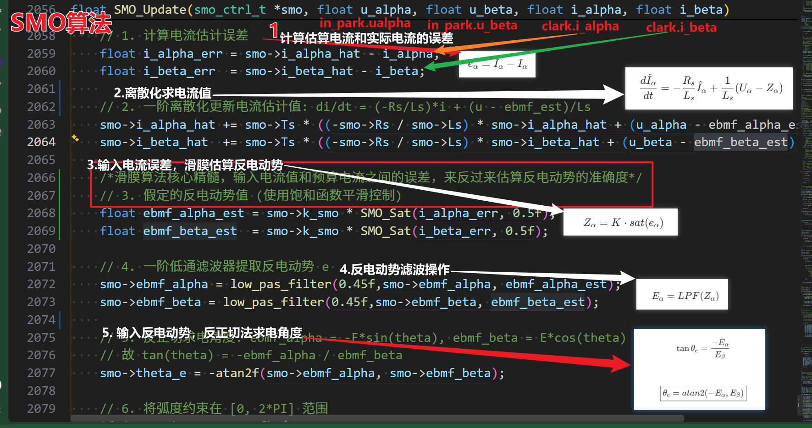

# 滑膜观测器整体工作流程总结

-------
---------
把 **SMO无感FOC估算电角度的数学流程**压缩成公式，就是下面这一套。

---

# 1. PMSM αβ数学模型

电机电压方程：

$$
U_\alpha=R_sI_\alpha+L_s\frac{dI_\alpha}{dt}+E_\alpha
$$

$$
U_\beta=R_sI_\beta+L_s\frac{dI_\beta}{dt}+E_\beta
$$

其中：

* \(U_{\alpha,\beta}\)：输入电压
* \(I_{\alpha,\beta}\)：测量电流
* \(R_s\)：定子电阻
* \(L_s\)：定子电感
* \(E_{\alpha,\beta}\)：反电动势

目标：

求：

$$
E_\alpha,E_\beta
$$

---

# 2. 建立电流观测模型

SMO建立：

$$
\frac{d\hat I_\alpha}{dt}
=
-\frac{R_s}{L_s}\hat I_\alpha
+
\frac{1}{L_s}(U_\alpha-Z_\alpha)
$$

β轴：

$$
\frac{d\hat I_\beta}{dt}
=
-\frac{R_s}{L_s}\hat I_\beta
+
\frac{1}{L_s}(U_\beta-Z_\beta)
$$

其中：

$$
\hat I
$$

是软件预测电流。

---

# 3. 计算电流误差

$$
e_\alpha=\hat I_\alpha-I_\alpha
$$

$$
e_\beta=\hat I_\beta-I_\beta
$$

---

# 4. 滑模控制器

传统：

$$
Z_\alpha=K\cdot sign(e_\alpha)
$$

$$
Z_\beta=K\cdot sign(e_\beta)
$$

实际工程：

用饱和函数：

$$
Z_\alpha
=
K\cdot sat(e_\alpha)
$$

$$
Z_\beta
=
K\cdot sat(e_\beta)
$$

---

# 5. 为什么Z就是反电动势？

当观测器稳定：

$$
\hat I=I
$$

即：

$$
e=0
$$

此时：

真实电机：

$$
U=RI+L\frac{dI}{dt}+E
$$

观测器：

$$
U=R\hat I+L\frac{d\hat I}{dt}+Z
$$

因为：

$$
\hat I=I
$$

所以：

$$
\boxed{Z=E}
$$

因此：

$$
Z_\alpha\rightarrow E_\alpha
$$

$$
Z_\beta\rightarrow E_\beta
$$

---

# 6. 低通滤波得到反电动势

因为：

$$
Z
$$

含高频开关：

所以：

$$
E_\alpha=LPF(Z_\alpha)
$$

$$
E_\beta=LPF(Z_\beta)
$$

---

# 7. 反电动势和转子角度关系

PMSM：

$$
E_\alpha=-E\sin\theta_e
$$

$$
E_\beta=E\cos\theta_e
$$

所以：

$$
\tan\theta_e
=
\frac{-E_\alpha}{E_\beta}
$$

得到：

$$
\boxed{
\theta_e
=
atan2(-E_\alpha,E_\beta)
}
$$

---

# 8. 最终完整公式链

压缩成一条：

$$
\boxed{
U,I
\rightarrow
\hat I
}
$$

$$
\boxed{
e=\hat I-I
}
$$

$$
\boxed{
Z=K\cdot sat(e)
}
$$

$$
\boxed{
E=LPF(Z)
}
$$

$$
\boxed{
\theta_e=atan2(-E_\alpha,E_\beta)
}
$$

---

如果再加PLL：

最后一步变：

原来：

$$
\theta_e=atan2(-E_\alpha,E_\beta)
$$

变成：

$$
E_{\alpha\beta}
\rightarrow
Park(\theta_{PLL})
\rightarrow
E_d
\rightarrow
PI
\rightarrow
\omega_e
\rightarrow
\int
\rightarrow
\theta_e
$$

也就是：

**SMO负责：**

$$
U,I \rightarrow E_{\alpha\beta}
$$

**PLL负责：**

$$
E_{\alpha\beta}\rightarrow\theta_e
$$

这就是工业无感FOC最经典的：

$$
\boxed{
SMO+PLL
}
$$

结构。
