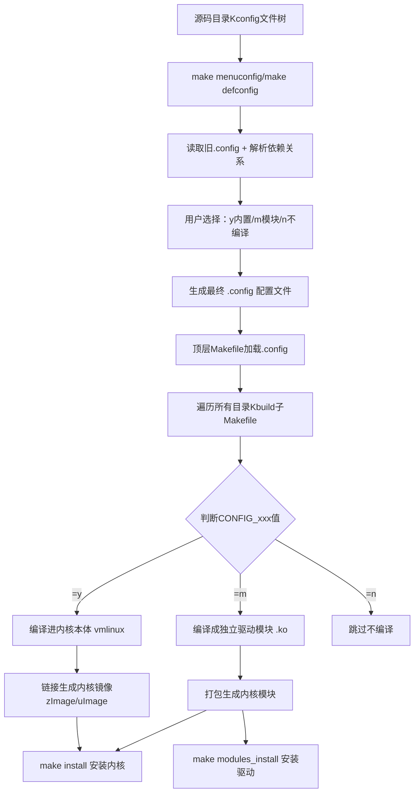

先说结论：Linux 内核这套“配置→编译”系统，本质是 **Kconfig（定义选项）+ .config（保存选择）+ Kbuild/Makefile（按配置编译）** 的分层系统，整体分两大阶段：**配置阶段**和**编译阶段**。下面按流程+原理拆开讲。

---

## 一、整体工作流程（一步一步）

### 1. 配置阶段：决定“编什么”
常用命令：
```bash
make menuconfig   # 文本图形界面（最常用）
make defconfig    # 生成默认配置（ARCH 相关）
make oldconfig    # 基于旧 .config 升级
```

流程：
1. **读 Kconfig 树**  
   从 `arch/$(ARCH)/Kconfig` 开始，递归读各级目录的 `Kconfig`，生成菜单结构和依赖关系图。
2. **读旧 .config（如果有）**  
   把上次的配置项读进来，作为默认选中状态。
3. **用户交互选择**  
   每个选项有三种状态：
   - `y`：内置，编译进内核镜像
   - `m`：模块，编译成 .ko 文件
   - `n`：不编译
   界面会自动处理依赖（比如选了 A 才显示 B）。
4. **保存为 .config**  
   退出时生成/更新根目录下的 `.config`，内容形如：
   ```
   CONFIG_NET=y
   CONFIG_PCI=m
   # CONFIG_USB is not set
   ```

> 关键产物：**.config**——整个编译过程的“总开关表”。

---

### 2. 编译阶段：按 .config 编译链接
常用命令：
```bash
make -j$(nproc)   # 编译内核+模块
make modules       # 只编模块
make install       # 安装内核镜像
make modules_install  # 安装模块
```

流程（Kbuild 系统干活）：
1. **顶层 Makefile 入口**  
   读 `.config`，把所有 `CONFIG_xxx` 变成 Makefile 变量。
2. **递归遍历目录**  
   从顶层到各子目录（`arch/`、`drivers/`、`fs/`…），执行每个目录下的 `Kbuild`（或 `Makefile`）。
3. **按条件编译文件**  
   每个目录的 Kbuild 语法：
   ```makefile
   obj-$(CONFIG_FOO) += foo.o
   ```
   - `CONFIG_FOO=y` → `obj-y += foo.o` 编入内核
   - `CONFIG_FOO=m` → `obj-m += foo.o` 编为模块
   - `=n` → 跳过
4. **编译 .c/.S → .o**  
   调用 gcc/as，生成目标文件，处理头文件依赖。
5. **链接 vmlinux（内核镜像）**  
   把所有 `obj-y` 的 .o 链接成 `vmlinux`（ELF 格式）。
6. **生成模块 .ko**  
   所有 `obj-m` 的文件编译链接成 `.ko`，带版本信息。
7. **后续安装**  
   `make install` 把 vmlinux/initramfs 拷到 `/boot`，更新 grub；  
   `make modules_install` 把 .ko 拷到 `/lib/modules/$(uname -r)`。

---

## 二、核心组件原理（Kconfig / .config / Kbuild）

### 1. Kconfig：描述“可以选什么、有什么依赖”
- 一种专用配置语言（DSL）。
- 每个 `config` 项对应一个 `CONFIG_xxx` 变量。
- 支持：
  - `bool`/`tristate`：二态/三态（y/m/n）
  - `depends on`：依赖其他选项
  - `select`：自动选中依赖项
  - `default`：默认值
- 所有 Kconfig 构成一棵**依赖树**，menuconfig 据此生成菜单并做依赖校验。

### 2. .config：配置的“数据库”
- 纯文本键值对，**编译系统唯一依据**。
- 只记录最终选择，不记录菜单结构。
- 可手动编辑，但容易破坏依赖关系，推荐用 `make *config` 修改。

### 3. Kbuild（内核版 Makefile）：条件编译引擎
- 基于 GNU Make，但做了大量封装（`obj-y`/`obj-m` 等）。
- **分层递归**：顶层 Makefile → 各级 Kbuild → 编译链接。
- **核心逻辑**：把 `.config` 中的 `CONFIG_xxx` 翻译成编译/链接规则。
- 自动处理：
  - 源文件依赖（头文件变更自动重编）
  - 模块编译规则（`.ko` 生成、符号版本）
  - 架构相关编译（`arch/$(ARCH)` 优先）

---

## 三、一句话总结原理
**Kconfig 定义可选功能与依赖 → menuconfig 生成 .config 记录用户选择 → Kbuild 根据 .config 中的 y/m/n，递归编译链接出内核镜像与模块。**

---

如果你愿意，我可以画一张**“配置→编译”流程图（含 Kconfig/.config/Kbuild 数据流）**，方便你一眼看懂整个链路。

----------
----------
-------
# Linux内核编译配置完整流程图+原理极简版
## 一、整体数据流流程图


## 二、三层核心原理（大白话）
1. **Kconfig 层：菜单规则层**
    写死**有哪些功能、谁依赖谁、能不能编译成模块**，只负责出菜单，不参与编译。

2. **.config 层：选择结果层**
    纯文本配置表，把所有功能的**开/关/模块化**全部记录，是整个编译的唯一指令。

3. **Kbuild/Makefile 层：执行编译层**
    读取`.config`里的`CONFIG_*`变量，用`obj-y/obj-m`自动判断编译方式，递归批量编译源码。

## 三、最简工作流程
1. 扫全部**Kconfig**搭建配置菜单
2. 人机交互勾选，保存成**.config**
3. Make读取配置，按**y/m/n**分类编译
4. 合并代码生成内核镜像 + 独立驱动模块

## 四、核心关键字作用
- `tristate`：三态选项（y/m/n）
- `depends on`：功能依赖，没开前置功能就看不到选项
- `obj-y`：编入内核
- `obj-m`：编成驱动模块
- `.config`：编译总开关文件

需要我给你整理**嵌入式Linux精简编译命令速查表**吗？
